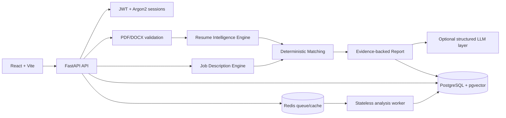

# ResumeIQ

ResumeIQ is an evidence-first AI resume intelligence platform. It parses resumes and job descriptions into structured data, compares requirements deterministically, and makes every important finding traceable to source evidence.

## Product promise

ResumeIQ separates:

- Resume facts
- Job requirements
- Matched evidence
- Missing information
- AI-generated recommendations

The system never turns a recommendation into a candidate fact and never treats semantic similarity as proof that a specific technology was used.

## Architecture



## Features

- Secure registration, login, logout, and protected resources
- Argon2 password hashing and revocable JWT sessions
- PDF and DOCX validation with size, integrity, archive, and path checks
- Structured resume extraction with page/line evidence
- JD skill, requirement, responsibility, and keyword extraction
- Exact, normalized, partial, and concept-level matching
- Transparent weighted score breakdowns
- Evidence ledger for matched and missing requirements
- Optional OpenAI/Gemini structured-output provider layer
- Grounding checks that reject unsupported AI claims
- Responsive React interface with lazy-loaded Three.js visualization
- Upload progress, processing states, analysis tabs, recommendations, and interview preparation
- Structured request logs, request IDs, secure headers, CORS restrictions, and rate limiting

## Stack

- Frontend: React 19, TypeScript, Vite, Tailwind CSS, Framer Motion, React Three Fiber, Drei, Lucide
- Backend: Python 3.12+, FastAPI, Pydantic, SQLAlchemy async, Alembic
- Data: PostgreSQL, pgvector-compatible image, JSONB structured reports
- Security: Argon2, JWT, CORS, Trusted Host, secure headers, request validation
- Testing: pytest, pytest-asyncio, Ruff, TypeScript/Vite production build

## Local setup

### Prerequisites

- Docker Desktop
- Node.js 20+
- Python 3.12+

### Environment

```powershell
Copy-Item .env.example .env
```

Set a unique `JWT_SECRET_KEY` and database password before any shared or production deployment. Never commit `.env` or provider keys.

Important variables:

- `DATABASE_URL`
- `JWT_SECRET_KEY`
- `CORS_ORIGINS`
- `ALLOWED_HOSTS`
- `LLM_PROVIDER`
- `LLM_API_KEY`
- `LLM_MODEL`
- `VECTOR_DATABASE_URL`
- `REDIS_URL` (set to `redis://localhost:6379/0` for local workers)
- `ANALYSIS_MAX_RETRIES`
- `ANALYSIS_VERSION`
- `RATE_LIMIT_WINDOW_SECONDS`

### One-command Docker startup

```powershell
docker compose up --build
```

Then open:

- Web app: http://localhost:5173
- API: http://localhost:8000
- Swagger/OpenAPI: http://localhost:8000/docs

The Compose stack starts PostgreSQL, runs Alembic migrations in the API container, starts FastAPI, and serves the built frontend through Nginx.

### Manual development

```powershell
docker compose up -d db
```
Start the API:

```powershell
cd backend
python -m venv .venv
.\.venv\Scripts\Activate.ps1
pip install -e ".[dev]"
alembic upgrade head
uvicorn app.main:app --reload --port 8000
```

Start the frontend:

```powershell
cd frontend
npm run dev
```

## Critical workflow

1. Register a user.
2. Log in.
3. Upload a valid PDF or DOCX resume.
4. Confirm parsed resume extraction and evidence.
5. Paste a job description.
6. Create an analysis and poll its job status while processing continues in the worker.
7. Inspect score breakdowns, matched skills, partial matches, missing skills, keywords, quality signals, and evidence.
8. Request interview questions when an AI provider is configured.
9. Refresh the browser; the latest workflow remains available in the workspace session and analysis remains persisted in PostgreSQL.
10. Sign out and sign back in to verify session revocation and reauthentication.

## API documentation

The authoritative OpenAPI document is generated by FastAPI:

- `/openapi.json`
- `/docs`

Primary resources:

- `POST /api/v1/auth/register`
- `POST /api/v1/auth/login`
- `POST /api/v1/auth/logout`
- `GET /api/v1/auth/me`
- `POST /api/v1/resumes/upload`
- `GET /api/v1/resumes/{resume_id}`
- `POST /api/v1/jobs`
- `POST /api/v1/analysis`
- `GET /api/v1/analysis/jobs/{job_id}`
- `POST /api/v1/analysis/jobs/{job_id}/retry`
- `GET /api/v1/analysis/{analysis_id}`
- `GET /api/v1/analysis/{analysis_id}/evidence`
- `POST /api/v1/analysis/{analysis_id}/interview-questions`
- `GET /api/v1/dashboard/overview`

## Testing

Backend lint and tests:

```powershell
cd backend
python -m ruff check app tests migrations
python -m pytest -q
```

Frontend production build:

```powershell
cd frontend
npm run build
```

The backend tests cover authentication, upload validation, extraction, JD parsing, matching, authorization, evidence persistence, AI schema validation, provider errors, timeouts, request IDs, secure headers, rate limiting, and the critical workflow using an isolated SQLite database.

## Deployment

- Deploy the frontend independently as static files behind a CDN or Nginx.
- Deploy the backend as the provided non-root container behind HTTPS and a reverse proxy/API gateway.
- Use managed PostgreSQL with pgvector in production.
- Store uploaded documents in private object storage for multi-instance deployments; the local volume is for development and single-node operation.
- Use a shared Redis or gateway rate limiter when running multiple API replicas; the included in-memory limiter is a local guardrail.
- Set a unique secret, explicit host/CORS allowlists, production logging destination, and real AI provider configuration through the deployment secret manager.

## Limitations

- OCR for image-only resumes is not implemented yet.
- The local storage adapter is development-only; configure an S3, Azure Blob, or Supabase adapter for production.
- AI interview generation is unavailable when `LLM_PROVIDER=stub`.
- Browser-level automated screenshots require a Playwright browser binary in the environment.
- Rate limiting is process-local until backed by a shared store.

## Future improvements

- OCR and layout-aware extraction for scanned resumes
- Durable Redis-backed analysis jobs with persisted progress and retry state
- Object storage and malware scanning integration
- Redis-backed rate limiting and cache
- Full frontend component and browser test suite
- Managed vector retrieval for semantic evidence search
- CI/CD, dependency scanning, SAST, and production metrics dashboards
