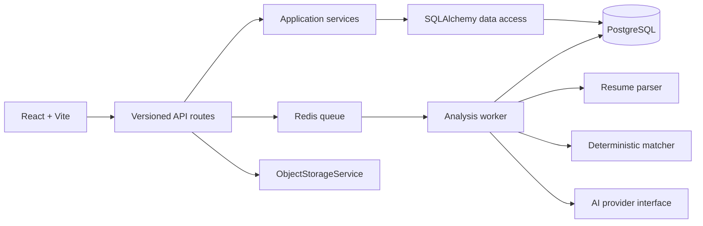

# Architecture

## Components

## Responsibilities

- Routes authenticate, validate input, enforce ownership, and return contracts.
- Services own transactions and workflow decisions.
- Repositories isolate persistence queries as the codebase grows.
- Workers are stateless and can run multiple replicas.
- AI adapters never expose credentials to the browser.
- PostgreSQL stores durable resource, job, report, and evidence state.

## Extension points

Resume processing, AI analysis, matching, and notifications are module boundaries that can later become services without changing the HTTP contract. Domain events are intentionally deferred; the current queue is sufficient for analysis jobs.
