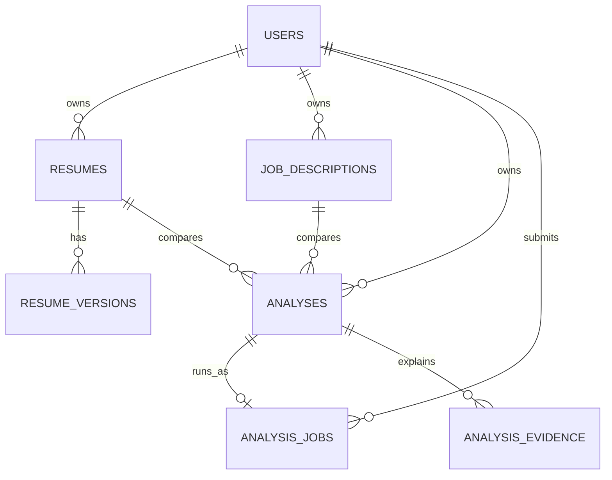

# Database Design

PostgreSQL is the source of truth. JSONB stores versioned extraction/report payloads while relational keys enforce ownership and lifecycle integrity.

## Analysis jobs

`analysis_jobs` contains `id`, `user_id`, `analysis_id`, `idempotency_key`, `status`, `progress`, `current_step`, `attempts`, `error_message`, retry/start/completion timestamps, and `created_at`. `(user_id, idempotency_key)` is unique, preventing duplicate provider work.

Important indexes cover user ownership, analysis lookup, and job status. New schema changes are Alembic migrations; deployment runs `alembic upgrade head` before serving traffic.

## Transaction boundaries

Analysis creation commits the analysis and job together. Worker completion commits the report, evidence, and terminal job state together. A failed transaction leaves the job retryable rather than a partial report.
