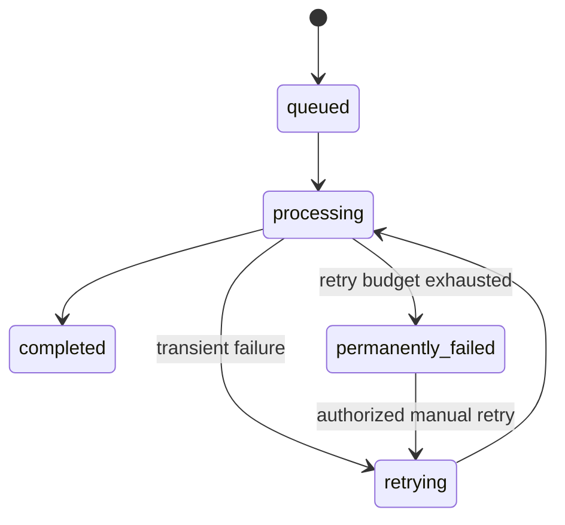

# Failure Handling

Workers persist attempts and safe error messages. Provider timeouts and transient failures are retryable; malformed source data and other permanent failures become terminal. `POST /api/v1/analysis/jobs/{job_id}/retry` provides an ownership-protected recovery path.

If Redis is unavailable, development uses a local fallback. Production should fail queue health checks visibly and use a managed Redis with monitoring. If a worker crashes after claiming a job, production needs a lease/visibility timeout reaper; this is a remaining hardening item before high-volume deployment.
