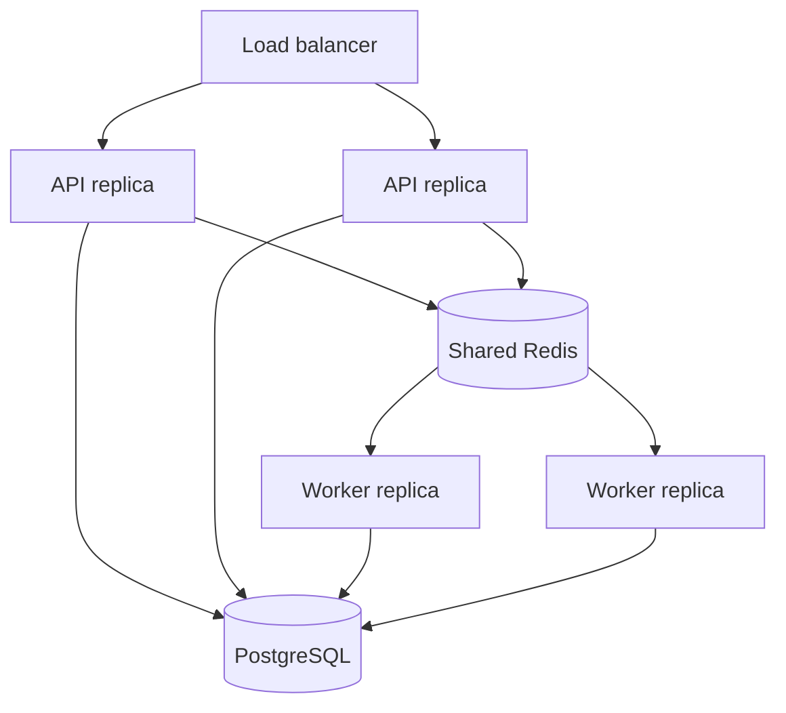

# Scalability

## Current design

Workers do not keep durable state in memory. Redis transports work; PostgreSQL owns status and results. The local fallback is for development only.

## Progression

1. PostgreSQL indexes and connection pooling.
2. Query profiling and read optimization.
3. Shared Redis queue/cache/rate-limit counters.
4. Read replicas for dashboard/report reads.
5. Partition large job/evidence tables only after measured growth.
6. Shard only with demonstrated tenant or volume pressure.

Kubernetes, Kafka, and microservices are intentionally deferred.
