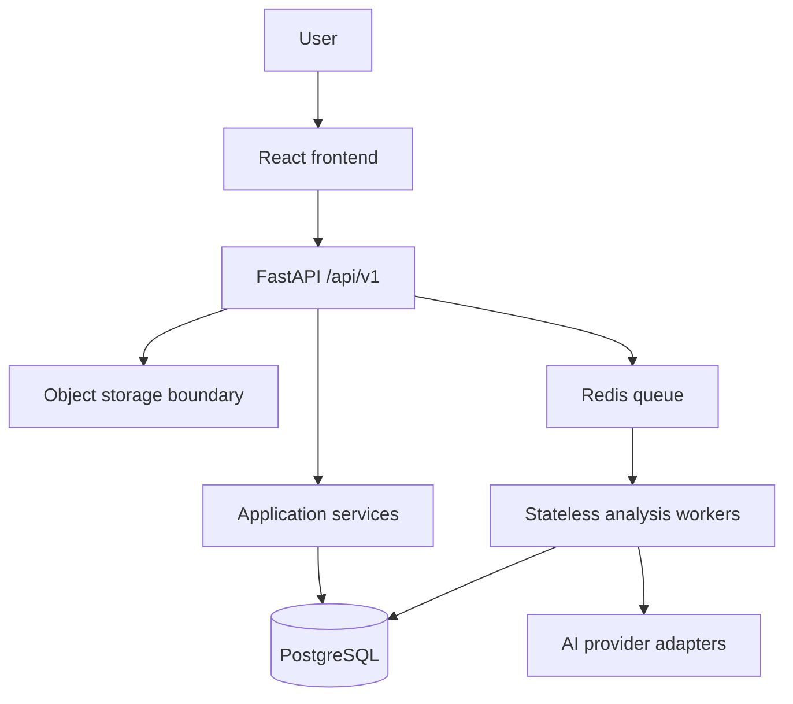
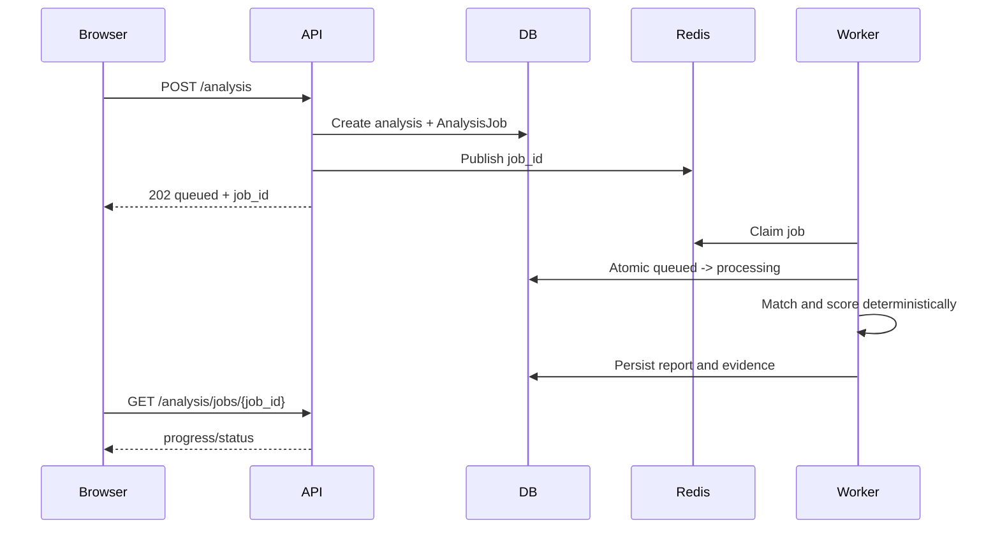

# ResumeIQ System Design

## Goal

ResumeIQ is a modular monolith with asynchronous analysis workers. PostgreSQL is the source of truth, Redis is a transport/cache extension, and uploaded documents remain outside the database through the storage boundary.

## Requirements

- Preserve authenticated resume, job, matching, recommendations, and dashboard workflows.
- Keep expensive analysis out of API request execution.
- Make job state durable, retryable, idempotent, and ownership-protected.
- Keep AI providers behind typed server-side adapters.

## High-level architecture

## Analysis data flow

## Boundaries

- Presentation: FastAPI routes and Pydantic schemas.
- Application: services and worker orchestration.
- Domain: extraction, matching, and scoring engines.
- Data access: SQLAlchemy models/repositories.
- Infrastructure: PostgreSQL, Redis, local/object storage, provider adapters.

## Deliberate tradeoff

The initial deployment remains a modular monolith. Redis and workers can scale independently, but Kafka, Kubernetes, sharding, and separate deployables are deferred until measured demand justifies them.
